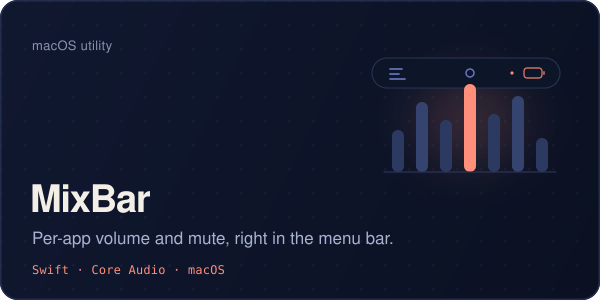
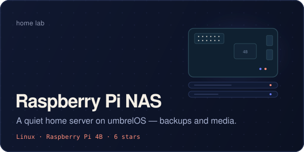
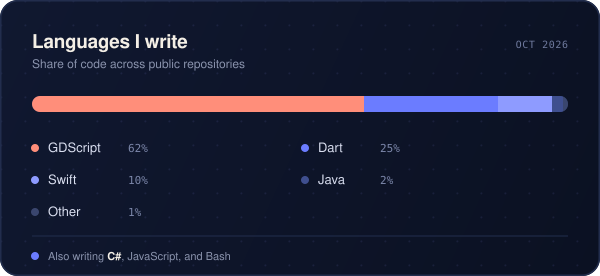

  <picture>
    <source media="(max-width: 640px)" srcset="https://raw.githubusercontent.com/hikara192/hikara192/main/assets/hero-mobile.svg">
    
  </picture>

I'm a developer from Vitebsk, Belarus. I build small, focused things: a macOS menu-bar mixer, a Flutter app for my university, and games in Godot. I like software that feels quiet, fast, and a little hand-made.

### Now

- Building **[MixBar](https://github.com/hikara192/MixBar)** — per-app volume and mute in the macOS menu bar, with no virtual audio driver.
- Maintaining **[VSTU HOME](https://github.com/hikara192/vstu-app)** — schedules, groups, and Moodle access for VSTU students.
- Exploring **Godot 4**, Core Audio, and a **[Raspberry Pi NAS](https://github.com/hikara192/NAS-server-on-raspberry-pi-)** running umbrelOS.

### Toolbox

  
  
  
  
  

  
  
  
  
  

### Selected work

<table>
  <tr>
    <td width="50%" valign="top">
      
    </td>
    <td width="50%" valign="top">
      
    </td>
  </tr>
  <tr>
    <td width="50%" valign="top">
      
    </td>
    <td width="50%" valign="top">
      
    </td>
  </tr>
</table>

### GitHub, lately

  
    
  

### Say hi

The fastest way to reach me is Telegram — I'm always up for a chat about macOS audio, Flutter, or Godot.

  
  

Vitebsk, Belarus · 55.19° N, 30.20° E

