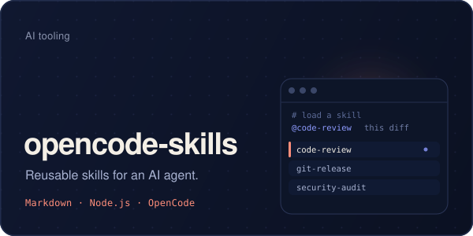
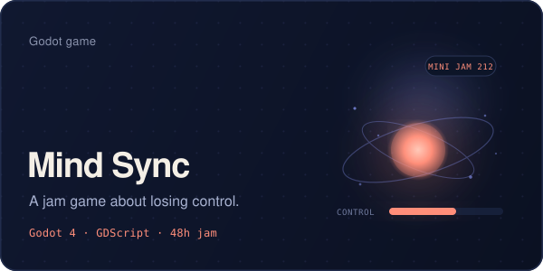

  <picture>
    <source media="(max-width: 640px)" srcset="https://raw.githubusercontent.com/hikara192/hikara192/main/assets/hero-mobile.svg?v=2">
    
  </picture>

I'm a first-year student at VSTU (Vitebsk State Technological University) and a developer from Vitebsk, Belarus. I build small, focused things: a macOS menu-bar mixer, a Flutter app for my university, games in Godot, and skills for AI coding agents. I like software that feels quiet, fast, and a little hand-made.

### Now

- Building **[MixBar](https://github.com/hikara192/MixBar)** — per-app volume and mute in the macOS menu bar, with no virtual audio driver.
- Building **[opencode-skills](https://github.com/hikara192/opencode-skills)** — review, release, testing and security skills for [OpenCode](https://opencode.ai).
- Maintaining **VSTU HOME** — a private Flutter app for VSTU students: schedules, groups, and Moodle access.
- Publishing small games on **[itch.io](https://hikara192.itch.io)** — *Mind Sync*, *data decay*, and whatever comes next.
- Exploring **Godot 4**, Core Audio, and a **[Raspberry Pi NAS](https://github.com/hikara192/NAS-server-on-raspberry-pi-)** running umbrelOS.

### Highlights

- **9th in Concept** and **9th in Use of the Limitation** at [Mini Jam 212: Control](https://itch.io/jam/mini-jam-212-control/results) with **[Mind Sync](https://hikara192.itch.io/mind-sync)**.
- **Finalist** at the MTS hackathon.
- **First-year student** at VSTU — Vitebsk State Technological University.

### Toolbox

  
  
  
  
  
  
  

  
  
  
  
  
  

### Selected work

<table>
  <tr>
    <td width="50%" valign="top">
      
    </td>
    <td width="50%" valign="top">
      
    </td>
  </tr>
  <tr>
    <td width="50%" valign="top">
      
    </td>
    <td width="50%" valign="top">
      
    </td>
  </tr>
  <tr>
    <td width="50%" valign="top">
      
    </td>
    <td width="50%" valign="top">
      
    </td>
  </tr>
</table>

### More projects

<table>
  <tr>
    <td width="33%" valign="top">
      <a href="https://github.com/hikara192/3D-horror-godot"><b>3D Horror</b></a> 
      A first-person horror experiment in Godot 4. 
      <code>Godot 4</code> · <code>GDScript</code>
    </td>
    <td width="33%" valign="top">
      <a href="https://github.com/hikara192/dream-of-scy-godot"><b>Dream of SCY</b></a> 
      A space scene with asteroids, planets and a black hole. 
      <code>Godot 4</code> · <code>GDScript</code>
    </td>
    <td width="33%" valign="top">
      <a href="https://github.com/hikara192/Garages-Sub-Ghz-flipper-zero"><b>Flipper Zero tools</b></a> 
      Sub-GHz garage remote, Bad USB Wi-Fi payload and a password list editor. 
      <code>Flipper Zero</code> · <code>Bad USB</code>
    </td>
  </tr>
</table>

### GitHub, lately

  
    
  

### Say hi

The fastest way to reach me is Telegram. I also publish games on itch.io — and I'm always up for a chat about macOS audio, Flutter, Godot, or AI coding agents.

  
  
  

Vitebsk, Belarus · 55.19° N, 30.20° E

